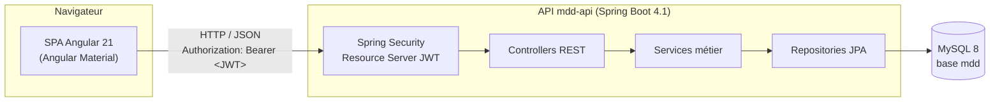
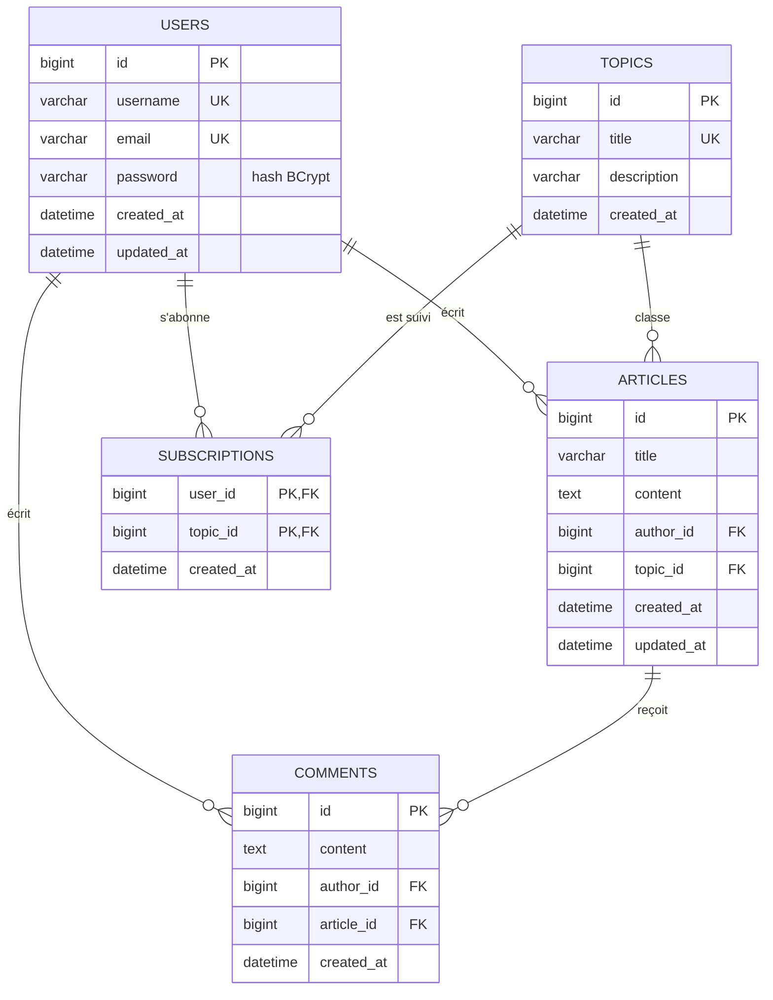
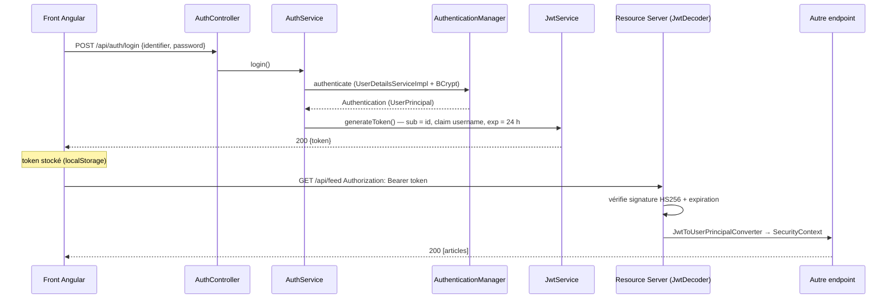
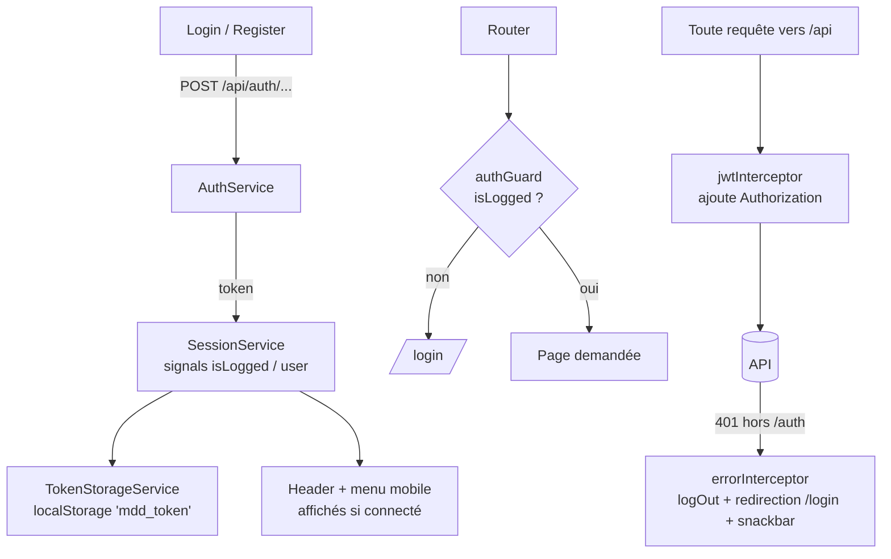
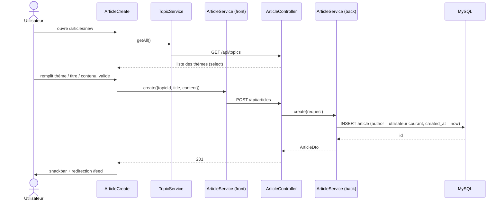

# MDD (Monde de Dév) — Architecture du MVP

> Réseau social pour développeurs : les utilisateurs s'abonnent à des **thèmes**
> (Java, Angular, DevOps…), consultent un **fil d'actualité** d'articles liés à
> leurs abonnements, publient des **articles** et les **commentent**.
>
> Code de départ : [Developpez-une-application-full-stack-complete](https://github.com/OpenClassrooms-Student-Center/Developpez-une-application-full-stack-complete)
> (`back/` Spring Boot `mdd-api`, `front/` Angular + Angular Material).

---

## 1. Périmètre fonctionnel du MVP

| # | Fonctionnalité | Détail |
|---|---|---|
| F1 | Inscription | nom d'utilisateur, e-mail, mot de passe |
| F2 | Connexion | avec **e-mail ou nom d'utilisateur** + mot de passe ; la session persiste entre deux visites |
| F3 | Déconnexion | |
| F4 | Profil | consulter / modifier nom d'utilisateur, e-mail, mot de passe ; voir ses abonnements et se désabonner |
| F5 | Thèmes | liste de tous les thèmes, s'abonner / se désabonner |
| F6 | Fil d'actualité | articles des thèmes suivis, tri chronologique **ascendant / descendant** |
| F7 | Créer un article | thème + titre + contenu ; auteur et date renseignés automatiquement |
| F8 | Consulter un article | thème, titre, auteur, date, contenu, commentaires |
| F9 | Commenter | auteur et date automatiques ; **pas de sous-commentaires** |

**Règles transverses**

- Mot de passe : ≥ 8 caractères, au moins 1 chiffre, 1 minuscule, 1 majuscule, 1 caractère spécial.
- E-mail et nom d'utilisateur **uniques**.
- Toutes les pages, sauf accueil / connexion / inscription, sont réservées aux utilisateurs connectés.
- Interface **responsive** (desktop + mobile, menu burger) conforme aux maquettes Figma.
- Hors périmètre MVP : création de thèmes par les utilisateurs (thèmes pré-chargés en base), édition / suppression d'articles, likes, sous-commentaires.

---

## 2. Vue d'ensemble



- **Architecture 3-tiers** : SPA Angular ↔ API REST stateless ↔ base relationnelle.
- **Authentification stateless par JWT** : pas de session serveur, le jeton signé (HS256) porte l'identité.
- En dev : front sur `http://localhost:4200`, API sur `http://localhost:8080/api`. Le proxy Angular (`proxy.conf.json`) relaie `/api` vers l'API : pas de CORS à gérer en dev.
- Contrat d'API consultable sur **Swagger UI** : `http://localhost:8080/swagger-ui.html`.

---

## 3. Choix techniques

| Couche | Choix | Justification |
|---|---|---|
| Langage back | **Java 21** (LTS) | Le starter est en Java 11 ; Java 21 est requis par Spring Boot 4. |
| Framework back | **Spring Boot 4.1** (Web, Data JPA, Security, Validation) | Spring Boot 2.7 du starter n'est plus maintenu ; montée de version faite dès le départ, avant d'écrire du code. |
| JWT | **Spring Security OAuth2 Resource Server** (Nimbus `JwtEncoder` / `JwtDecoder`, HS256) | Validation du jeton (signature + expiration) fournie par Spring Security, pas de filtre maison à maintenir. |
| Mapping | **MapStruct** | Conversion entité ↔ DTO générée à la compilation, pas d'exposition des entités JPA. |
| Boilerplate | Lombok | Getters/setters/builders, injection par constructeur (`@RequiredArgsConstructor`). |
| Base | **MySQL 8** | Imposée par le starter (`mysql-connector`). |
| Schéma | Script SQL versionné (`database/schema.sql`) ; Flyway envisageable ensuite | `ddl-auto=validate` : Hibernate vérifie mais ne modifie pas le schéma. |
| Hash mot de passe | **BCrypt** (`BCryptPasswordEncoder`) | Standard Spring Security. |
| Doc API | **springdoc-openapi 3.1** (Swagger UI) | Contrat d'API généré depuis le code et les annotations ; springdoc 3.x est la version compatible Spring Boot 4. |
| Front | **Angular 21** + **Angular Material** | Starter v14 réécrit en Angular 21 : composants standalone, signals, sans zone.js, routes chargées à la demande. |
| Style | SCSS + breakpoints `@angular/cdk/layout` | Responsive conforme Figma. |
| Tests | JUnit 5 + Mockito + `@SpringBootTest`/MockMvc sur H2 (back) ; Vitest + jsdom et Cypress (front) | |

---

## 4. Modèle de données



Points de conception :

- **Abonnement = table de jointure** `subscriptions` (clé primaire composite `user_id, topic_id`) → impossible de s'abonner deux fois au même thème.
- Un article appartient à **un seul** thème (exigence MVP).
- Commentaires **à plat** : pas de `parent_id`, conformément au périmètre.
- Index sur `articles(topic_id, created_at)` pour le fil d'actualité et `comments(article_id, created_at)`.
- Suppression : `ON DELETE CASCADE` des abonnements / commentaires si un utilisateur ou un article disparaît.

Script complet : [`database/schema.sql`](database/schema.sql) (+ jeu de thèmes initial dans [`database/data.sql`](database/data.sql)).

---

## 5. API REST

Préfixe : `/api`. Format JSON. Toutes les routes exigent `Authorization: Bearer <token>` sauf celles marquées 🔓.

La documentation interactive (schémas, exemples, bouton **Authorize** pour le JWT) est générée par springdoc :

| | URL |
|---|---|
| 🔓 Swagger UI | `http://localhost:8080/swagger-ui.html` |
| 🔓 Contrat OpenAPI JSON | `http://localhost:8080/v3/api-docs` |

### 5.1 Authentification

| Méthode | Route | Corps | Réponse | Notes |
|---|---|---|---|---|
| POST 🔓 | `/api/auth/register` | `{ username, email, password }` | `201 { token }` | Connexion automatique après inscription. `400` si données invalides ou e-mail / username déjà pris. |
| POST 🔓 | `/api/auth/login` | `{ identifier, password }` | `200 { token }` | `identifier` = e-mail **ou** username. `401` si identifiants invalides. |

La déconnexion est **côté client** (suppression du jeton) : l'API étant stateless, il n'y a rien à invalider côté serveur pour le MVP.

### 5.2 Utilisateur courant

| Méthode | Route | Corps | Réponse |
|---|---|---|---|
| GET | `/api/users/me` | — | `UserDto { id, username, email, createdAt }` |
| PUT | `/api/users/me` | `{ username, email, password? }` | `200 { user: UserDto, token }` — nouveau jeton renvoyé |
| GET | `/api/users/me/subscriptions` | — | `TopicDto[]` (thèmes suivis, pour la page profil) |

### 5.3 Thèmes et abonnements

| Méthode | Route | Réponse |
|---|---|---|
| GET | `/api/topics` | `TopicDto[] { id, title, description, subscribed }` |
| POST | `/api/topics/{id}/subscribe` | `201` |
| DELETE | `/api/topics/{id}/subscribe` | `204` |

### 5.4 Articles et fil d'actualité

| Méthode | Route | Corps / params | Réponse |
|---|---|---|---|
| GET | `/api/feed` | `?sort=desc\|asc` (défaut `desc`) | `ArticleSummaryDto[] { id, title, excerpt, authorUsername, topicTitle, createdAt }` |
| GET | `/api/articles/{id}` | — | `ArticleDto { id, title, content, authorUsername, topicId, topicTitle, createdAt }` |
| POST | `/api/articles` | `{ topicId, title, content }` | `201 ArticleDto` |

Le fil = articles dont le thème fait partie des abonnements de l'utilisateur : une requête JPQL avec `JOIN FETCH` sur l'auteur et le thème (pas de N+1), triée par `createdAt` selon `sort`.

### 5.5 Commentaires

| Méthode | Route | Corps | Réponse |
|---|---|---|---|
| GET | `/api/articles/{articleId}/comments` | — | `CommentDto[] { id, content, authorUsername, createdAt }` |
| POST | `/api/articles/{articleId}/comments` | `{ content }` | `201 CommentDto` |

### 5.6 Format d'erreur

Format cible, `ApiError` :

```json
{ "status": 401, "error": "Unauthorized", "message": "Authentification requise", "timestamp": "2026-10-12T10:00:00Z" }
```

Le champ `fields` (détail par champ) est ajouté pour les erreurs de validation. Le front lit `message` pour l'afficher (`core/models/api-error.ts`).

État actuel :

| Cas | Statut | Corps |
|---|---|---|
| Non authentifié / jeton invalide | `401` | `ApiError` (`SecurityConfig`) |
| Accès refusé | `403` | `ApiError` (`SecurityConfig`) |
| E-mail / username déjà pris à l'inscription | `400` | `{ "error": "..." }` (`GlobalExceptionHandler`) |
| Validation `@Valid` | `400` | réponse d'erreur par défaut de Spring |
| `NotFoundException`, `ConflictException` | `500` | non gérées pour l'instant (voir §10) |

---

## 6. Architecture back-end

### 6.1 Découpage en couches

```
back/src/main/java/com/openclassrooms/mddapi/
├── MddApiApplication.java
├── config/            # SecurityConfig (filtres, routes publiques), JwtConfig (JwtEncoder/Decoder),
│                      # OpenApiConfig (Swagger + schéma d'authentification bearer)
├── security/
│   ├── jwt/           # JwtService (génère le jeton), JwtProperties (mdd.jwt.*)
│   ├── JwtToUserPrincipalConverter.java  # JWT validé → UserPrincipal
│   ├── UserPrincipal.java
│   ├── UserDetailsServiceImpl.java       # charge par e-mail ou username (login)
│   └── CurrentUserProvider.java          # id / entité de l'utilisateur connecté
├── controller/        # AuthController, UserController, TopicController,
│                      # ArticleController, feedController, CommentController
├── dto/
│   ├── TopicDto.java
│   ├── request/       # RegisterRequest, LoginRequest, UpdateUserRequest,
│   │                  # CreateArticleRequest, CreateCommentRequest
│   └── response/      # AuthResponse, UserDto, UpdateUserResponse, ArticleDto,
│                      # ArticleSummaryDto, CommentDto, ApiError
├── mapper/            # UserMapper, TopicMapper, ArticleMapper, CommentMapper (MapStruct)
├── service/           # interfaces AuthService, UserService, TopicService,
│   └── impl/          # ArticleService, CommentService + implémentations
├── repository/        # UserRepository, TopicRepository, ArticleRepository,
│                      # CommentRepository (Spring Data JPA)
├── model/             # User, Topic, Article, Comment (entités JPA)
├── validation/        # @Password + PasswordValidator
└── exception/         # NotFoundException, ConflictException, EmailAlreadyUsedException,
                       # UsernameAlreadyUsedException, GlobalExceptionHandler
```

Règles :

- **Controller** : HTTP uniquement (validation `@Valid`, codes de statut, annotations Swagger) ; aucune logique métier.
- **Service** : logique métier + transactions (`@Transactional`) ; lit l'utilisateur courant via `CurrentUserProvider` (SecurityContext).
- **Repository** : accès aux données, pas de logique.
- Les **entités ne sortent jamais** de la couche service : seuls des DTO (records Java) sont exposés.
- Relations JPA en `FetchType.LAZY` ; le fil, le détail d'article et les commentaires utilisent des requêtes dédiées avec `JOIN FETCH` pour éviter le N+1.

### 6.2 Abonnements en JPA

`User` porte un `@ManyToMany` vers `Topic` via la table `subscriptions` :

```java
@ManyToMany(fetch = FetchType.LAZY)
@JoinTable(name = "subscriptions",
    joinColumns = @JoinColumn(name = "user_id"),
    inverseJoinColumns = @JoinColumn(name = "topic_id"))
private Set<Topic> topics = new HashSet<>();
```

### 6.3 Sécurité



- `SecurityFilterChain` : `csrf` désactivé (API stateless, pas de cookie), `SessionCreationPolicy.STATELESS`, `oauth2ResourceServer().jwt()` avec un convertisseur vers `UserPrincipal`.
- Routes publiques : `/api/auth/**`, `/error`, `/swagger-ui/**`, `/swagger-ui.html`, `/v3/api-docs/**`. Tout le reste est `authenticated()`.
- Les erreurs 401 / 403 de Spring Security sont renvoyées au format `ApiError` JSON.
- **Le `subject` du JWT est l'id utilisateur** (et non l'e-mail) : l'utilisateur peut modifier e-mail et username sans invalider son identité ; un nouveau jeton est tout de même renvoyé après mise à jour du profil (le claim `username` change).
- Secret JWT et identifiants BDD lus depuis des **variables d'environnement** (`JWT_SECRET`, `DB_URL`, `DB_USERNAME`, `DB_PASSWORD`), jamais commités. En local, ils sont placés dans `back/.env` (ignoré par Git).
- Durée de vie du jeton : 24 h (`mdd.jwt.jwtExpiration`, en heures) → répond à « rester connecté entre les sessions » sans refresh token pour le MVP.
- Mot de passe validé par l'annotation `@Password` (`PasswordValidator`) à l'inscription et lors du changement de mot de passe (optionnel dans `UpdateUserRequest`).

### 6.4 Documentation OpenAPI

- `OpenApiConfig` déclare le titre de l'API, le serveur local et un schéma de sécurité `bearerAuth` (HTTP bearer, format JWT) appliqué **par défaut à toutes les routes**.
- `AuthController` est annoté `@SecurityRequirements` (vide) : ses routes apparaissent sans cadenas dans Swagger.
- Chaque controller porte un `@Tag` (groupe dans l'UI) ; chaque route un `@Operation` (résumé) et des `@ApiResponse` (codes possibles).
- Les DTO de requête portent des `@Schema(description, example)` : Swagger UI pré-remplit les corps de requête.
- `OpenApiDocsTest` vérifie que `/v3/api-docs` et Swagger UI répondent sans jeton.

### 6.5 Configuration (`application.yml`)

```yaml
server:
  port: 8080
spring:
  config:
    import: optional:file:.env[.properties]
  datasource:
    url: ${DB_URL:jdbc:mysql://localhost:3306/mdd}
    username: ${DB_USERNAME}
    password: ${DB_PASSWORD}
  jpa:
    hibernate:
      ddl-auto: validate
    open-in-view: false
mdd:
  jwt:
    jwtSecret: ${JWT_SECRET}
    jwtExpiration: 24        # heures
  cors:
    allowed-origins: http://localhost:4200
```

Les tests utilisent `application-test.yml` (profil `test`) : base H2 en mode MySQL, `ddl-auto: create-drop` et un secret JWT de test.

---

## 7. Architecture front-end

### 7.1 Pages (d'après les maquettes)

| Route | Composant | Accès |
|---|---|---|
| `/` | `Landing` (logo + boutons « Se connecter » / « S'inscrire ») | public — redirige vers `/feed` si déjà connecté |
| `/login` | `Login` | public (idem) |
| `/register` | `Register` | public (idem) |
| `/feed` | `Feed` (cartes articles + bouton « Créer un article » + tri) | connecté |
| `/articles/new` | `ArticleCreate` | connecté |
| `/articles/:id` | `ArticleDetail` (article + `CommentList` + `CommentForm`) | connecté |
| `/topics` | `TopicList` (cartes thèmes + bouton S'abonner) | connecté |
| `/me` | `Profile` (formulaire profil + abonnements + déconnexion) | connecté |
| `**` | `NotFound` | public |

### 7.2 Structure du projet

```
front/src/
├── app/
│   ├── app.config.ts             # providers : router, HttpClient + intercepteurs, locale fr, restauration de session
│   ├── app.routes.ts             # routes lazy (loadComponent) + guards
│   ├── app.ts / app.html         # <app-header>, menu latéral mobile (mat-sidenav), <router-outlet>
│   ├── core/                     # singletons
│   │   ├── guards/       auth.guards.ts        # authGuard, unauthGuard (fonctions)
│   │   ├── interceptors/ jwt.interceptor.ts, error.interceptor.ts
│   │   ├── services/     session.service.ts    # état d'authentification (signals)
│   │   │                 token-storage.service.ts  # lecture/écriture du jeton en localStorage
│   │   └── models/       user, auth, topic, article, comment, api-error
│   ├── shared/                   # réutilisable, sans état
│   │   ├── components/   header/ (nav desktop + bouton burger), back-button/,
│   │   │                 topic-card/, article-card/, form-error/
│   │   ├── validators/   password.validator.ts (même règle que le back), not-blank.validator.ts
│   │   └── nav-links.ts          # liens de navigation (header + menu mobile)
│   ├── features/
│   │   ├── auth/         landing/, login/, register/, auth.service.ts
│   │   ├── articles/     feed/, article-create/, article-detail/, comment-list/,
│   │   │                 comment-form/, article.service.ts, comment.service.ts
│   │   ├── topics/       topic-list/, topic.service.ts
│   │   └── profile/      profile/, user.service.ts
│   └── pages/not-found/
├── environments/                 # apiUrl = '/api' (dev via proxy, prod même origine)
└── styles/                       # styles.scss, _variables.scss (couleurs Figma, espacements)
```

Principes :

- **Composants standalone**, pas de `NgModule` ; **zoneless** (pas de zone.js) avec `ChangeDetectionStrategy.OnPush`.
- **Lazy loading** par page (`loadComponent`) : la page de connexion ne charge pas le code du fil d'actualité.
- **Signals** pour l'état (`SessionService.isLogged`, `user`) ; `toSignal()` pour convertir les flux RxJS (router, breakpoints).
- **Composants « smart / dumb »** : les pages appellent les services ; les composants partagés (`ArticleCard`, `TopicCard`) n'utilisent que `input()` / `output()`.
- `TopicCard` est réutilisé sur la page Thèmes (« S'abonner ») et la page Profil (« Se désabonner »).
- Un **service HTTP par ressource**, qui retourne des `Observable` typés ; URL de base dans `environment.ts`.
- **Formulaires réactifs** avec validateurs alignés sur le back (`passwordValidator`, `notBlankValidator`).
- Paramètres de route passés directement aux inputs des composants (`withComponentInputBinding`).

### 7.3 Authentification côté client



- Jeton stocké en `localStorage` pour survivre à la fermeture du navigateur (exigence F2). Risque XSS atténué par l'échappement natif d'Angular et l'absence d'`innerHTML` ; un cookie `HttpOnly` est l'évolution prévue après le MVP.
- Au démarrage (`provideAppInitializer`), `SessionService.restore()` relit le jeton et appelle `GET /api/users/me` pour restaurer l'utilisateur.
- Après modification du profil, `SessionService.update()` remplace le jeton par celui renvoyé par l'API.
- `errorInterceptor` affiche aussi une snackbar si le serveur est injoignable (statut `0`) ou en cas d'erreur `5xx`.

### 7.4 Responsive

- Breakpoints via `BreakpointObserver` (`Handset`, `TabletPortrait`) : bouton burger qui ouvre un `mat-sidenav`, sinon barre de navigation.
- Grilles d'articles et de thèmes en CSS Grid : 2 colonnes desktop, 1 colonne mobile.
- Variables SCSS centralisées (couleurs Figma, espacements) dans `styles/_variables.scss`.

---

## 8. Parcours type : création d'un article



---

## 9. Qualité, tests et conventions

- **Back** (`./mvnw test`, base H2 en mémoire) :
  - tests unitaires des services (Mockito) : `AuthServiceImpl`, `UserServiceImpl`, `TopicServiceImpl`, `ArticleServiceImpl`, `CommentServiceImpl` ;
  - `JwtServiceTest`, `PasswordValidatorTest` ;
  - `ApiIntegrationTest` : parcours complet de l'API (`@SpringBootTest` + `MockMvc`) ;
  - `OpenApiDocsTest` : documentation Swagger générée et publique.
- **Front** :
  - tests unitaires Vitest + jsdom (`npx ng test --watch=false`) : guards, intercepteurs, `SessionService`, services HTTP, `Login`, `TopicCard`, validateurs ;
  - tests end-to-end Cypress (`npm run cypress:run`) : page d'accueil et navigation.
- **Git** : branche `main` stable, branches `feature/<sujet>`, commits conventionnels (`feat:`, `fix:`, `test:`, `docs:`).
- Principes : SOLID, DRY, injection par constructeur, pas de logique dans les templates.

---

